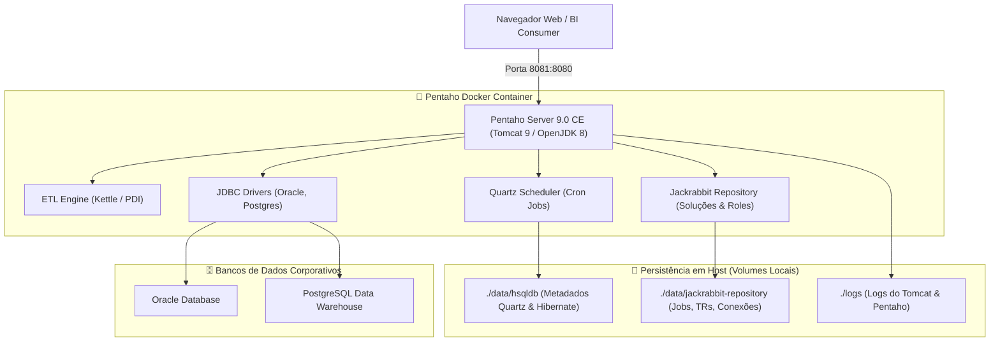

# Pentaho Business Analytics Server 9.0 (Docker Edition)

[](https://www.docker.com/)
[](https://openjdk.org/)
[](https://www.hitachivantara.com/)
[](#)

Implantação conteinerizada e pronta para produção do **Pentaho Business Analytics Server 9.0 (Community Edition)**. 

Este projeto empacota o ecossistema completo do Pentaho Server com suporte pré-configurado a drivers JDBC corporativos (PostgreSQL, Oracle Database), persistência em volumes locais para repositórios Jackrabbit e HSQLDB de agendamentos (Quartz), além de execução segura sob usuário não-root (`pentaho`).

---

## 🏗️ Arquitetura do Container



---

## 🚀 Como Executar

### 1. Pré-requisitos
- Docker Engine >= 20.10
- Docker Compose >= 1.29 ou Docker Compose v2

### 2. Criar a Rede Docker e Subir o Serviço
```bash
# Criar a rede compartilhada
docker network create network_pentaho 2>/dev/null || true

# Subir o container (build da imagem local)
docker-compose up -d --build
```

### 3. Acessar a Interface Web
Acesse no seu navegador:
* **URL:** `http://localhost:8081/pentaho`
* **Usuário Padrão:** `admin`
* **Senha Padrão:** `password`

---

## ⚙️ Estrutura do Repositório

```plaintext
pentaho-server-docker/
├── data/
│   ├── hsqldb/                 # Metadados de agendamentos e hibernate
│   └── jackrabbit-repository/  # Repositório de usuários, conexões e transformações
├── lib/                        # Drivers JDBC adicionais (Oracle, PostgreSQL)
├── docker-compose.yml          # Definição dos serviços, portas e volumes
├── Dockerfile                  # Construção da imagem baseada em OpenJDK 8
└── README.md                   # Documentação técnica e operacional
```

---

## 🔒 Segurança e Boas Práticas
- **Usuário Não-Root:** O serviço executa estritamente sob o usuário de sistema `pentaho` (UID dedicado), garantindo conformidade com padrões de segurança corporativos.
- **Persistência Externa:** Nenhuma transformação (`.ktr`), job (`.kjb`) ou agendamento é perdido em reinicializações ou updates do container, graças ao isolamento dos volumes em `./data/`.

---

## 👤 Autor

**Marcos Vasconcellos de Andrade**  
*Consultor de TI & Especialista em Infraestrutura Linux, Engenharia de Dados & IA Privada*  
- **GitHub:** [@marcos-data-engineer](https://github.com/marcos-data-engineer)  
- **LinkedIn:** [Marcos Vasconcellos de Andrade](https://www.linkedin.com/in/marcos-data-engineer)  
- **Blog:** [Arquitetura de Dados & IA](https://marcos-data-engineer.github.io/blog/)  
